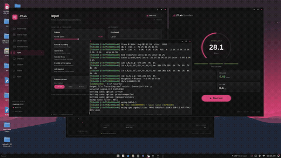

# JTDE

## Preview



[Watch the full video](src/re.mp4)

`install-jt-binaries.sh` is an initial-install helper for the repositories
managed by jtupdate. On Arch, Debian/Ubuntu, and Fedora it installs the build
dependencies, clones each managed repo, builds it, and installs everything in
one elevated pass (so you only enter your password once).


## Usage

```sh
./install-jt-binaries.sh --check          # list dependencies and their status
./install-jt-binaries.sh                  # install everything
```

Options: `--base-dir DIR` (default: `$HOME/jtupdate/repos`), `-h`/`--help`.
Environment: `JTUPDATE_BASE_DIR`, `JOBS` (default: `2`).

## jtgreeter / login manager

### OpenRC (requires elogind installed and running at startup)

OpenRC is supported. From the jtgreeter checkout, run the install command with
the extra `greeter` target, then switch over your login manager immediately:

```sh
sudo make install greeter

** DISABLE YOUR CURRENT LOGIN MANAGER ** and enable jtgreeter with:
sudo rc-update add jtgreeter default

** project dir in ~/jtupdate/repos/jtgreeter
```

`make install greeter` comments out the active `tty1` getty/agetty entries in
`/etc/inittab` (backed up to `/etc/inittab.bak.jtgreeter`) and reloads init
right away. **Do not reboot or log out before disabling your old login manager
and enabling `jtgreeter`**, or you may be left without a login prompt on
`tty1`.

### systemd


**Do not enable the systemd service.** systemd support is still experimental
and may cause issues on your system. Leave your current display manager in
place.
